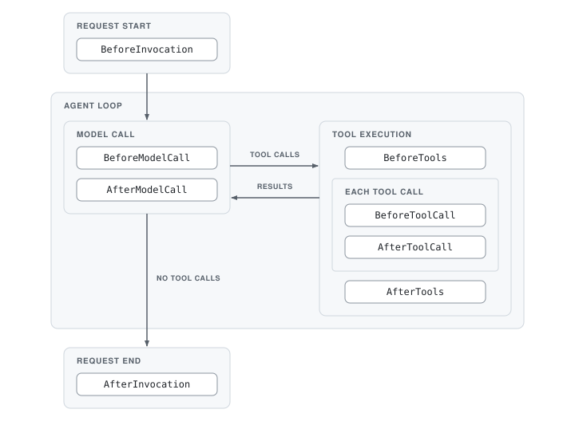

# (WIP) Foundation Models Harness


## Overview

Foundation Models Harness is a Swift package for building and running AI agents on top of Apple's [Foundation Models](https://developer.apple.com/documentation/foundationmodels) framework, inspired by [Strands Agents](https://github.com/strands-agents/harness-sdk). It wraps a `LanguageModelSession` in an `Agent` that owns the agent loop: model calls, tool execution, and the lifecycle around them all run in your process, with no hosted control plane.

On top of the plain session, you get:

- **An explicit agent loop.** Tools are invoked programmatically by the harness instead of the framework, so every model call and every tool call can be observed, mutated, cancelled, or retried.
- **[Hooks](#hooks)** to intercept any step of the loop to log it, validate it, or redirect it.
- **[Plugins](#plugins)** to bundle hooks and tools into reusable behaviors.
- **[Tool delegation](#tool-delegation)** to return a tool's output directly to the user as the final answer.
- **State** shared between the app, hooks, and tools: `agentState` persists across requests, and `invocationState` lives for a single invocation. Neither is sent to the model.
- **Streaming** via `streamResponse`, emitting model snapshots, tool calls, tool results, and the final result as `AgentStreamEvent`s.

Requires iOS / macOS / visionOS / watchOS 27.2+ and Swift 6.4+.

### Quick Start

```swift
import FoundationModels
import FoundationModelsHarness

let agent = Agent(
    model: SystemLanguageModel(),
    tools: [.init(tool: GreetingTool())],
    instruction: .init("You are a helpful assistant.")
)

// Single response
let result = await agent.respond(to: "greet itsuki")
print(result)

// Streaming
for await event in agent.streamResponse(to: "greet dan") {
    print(event)
}
```

`respond` and `streamResponse` never throw. The outcome, including errors, comes back on the `AgentResult`. Per-call parameters (`schema`, `options`, `metadata`, `contextOptions`, `invocationState`, `toolExecutionMode`) fall back to `Agent.defaultInvocationOptions` when `nil`.

Tool calls the model emits in a single turn run in parallel by default. Pass `toolExecutionMode: .sequential` to run them one at a time.

See [`Examples/`](Examples/) for runnable examples.


## Hooks

Hooks let you add logging, validation, guardrails, or custom logic at any point in the agent loop. Lifecycle events come in Before/After pairs that bracket agent operations: if a *before* event fires, its *after* event is guaranteed to fire.

### Lifecycle



| Event | When | What a callback can do |
|-------|------|------------------------|
| `BeforeInvocationEventHandler` | Start of an agent request, before the prompt is added to the history | Mutate `prompt`; set `cancel` to end the invocation with that content as the response |
| `BeforeModelCallEventHandler` | Just before the model is invoked | Set `cancel` to skip the model call with that content as the response |
| `BeforeToolsEventHandler` | Before executing the tool calls of a turn | Set `cancel` to cancel all tool calls with that content as their output |
| `BeforeToolCallEventHandler` | Just before a single tool is executed | Mutate `toolCall` (name / arguments); set `cancel` to cancel the call with that content as its output |
| `AfterToolCallEventHandler` | After a single tool completes | Mutate `toolResult`; set `retry` to run the tool again (`attemptCount` available) |
| `AfterToolsEventHandler` | After all tool calls of a turn complete | Set `endTurn` to end the loop with that content as the final response |
| `AfterModelCallEventHandler` | After the model call completes | Mutate `stopReason` (`endTurn` / `toolUse` / `refusal`); set `retry` to call the model again (`attemptCount` available) |
| `AfterInvocationEventHandler` | End of an agent request | Read `result`; set `retry` to rerun the invocation, or `resume` with a new prompt |

Every event payload also carries an `agent` snapshot to read the `history` and read or write `agentState` / `invocationState`.

```swift
let id = agent.addHook(
    BeforeToolCallEventHandler(callback: { event in
        // count tool calls in the agent state
        let count = event.agent.agentState["tool_count"]?.asInt() ?? 0
        event.agent.agentState["tool_count"] = .number(Double(count + 1))
    })
)

agent.addHook(
    AfterModelCallEventHandler(callback: { event in
        // retry once on refusal
        if case .refusal = event.stopReason, event.attemptCount < 2 {
            event.retry = true
        }
    })
)

agent.removeHook(id)
agent.removeHooks(for: [.afterModelCall])
agent.removeAllHooks()
```

### Ordering

Before callbacks run in registration order. After callbacks run in reverse registration order for cleanup symmetry. Override this with an explicit `order` in `HookCallbackOptions`: lower values run first. `BuiltInHookOrder` provides reference points, with `sdkFirst` / `sdkLast` marking where the SDK's own hooks run.

```swift
agent.addHook(
    BeforeToolCallEventHandler(
        callback: { event in event.cancel = "failed to greet. Do it yourself." },
        // cancellation is last-wins, so run it after the SDK's hooks
        options: .init(order: BuiltInHookOrder.sdkLast.rawValue + 1)
    )
)
```

Mutations such as `cancel`, `retry`, and `endTurn` are last-wins across callbacks.

See [`Examples/Hooks/`](Examples/Hooks/) for an example per event.


## Plugins

Plugins change the typical behavior of an agent. They let you introduce concepts like skills, steering, or other behavioral modifications into the agent loop by composing the low-level primitives the `Agent` exposes: hooks and tools.

Implement the `Plugin` protocol:

```swift
struct LoggingPlugin: Plugin {
    static let name: PluginName = "LoggingPlugin"

    var tools: [ToolConfig] = []

    var hooks: [any HookEventHandler] {
        [
            BeforeModelCallEventHandler(callback: { event in
                print("model call: \(event.agent.history.count) entries")
            }),
            AfterToolCallEventHandler(callback: { event in
                print("tool result: \(event.toolResult)")
            }),
        ]
    }
}

agent.addPlugin(LoggingPlugin())
agent.removePlugin(LoggingPlugin.name)
```

Adding a plugin registers its hooks and tools on the agent. Removing it unregisters exactly those hooks and tools. A plugin whose `name` is already registered is ignored.


## Tool Delegation

By default, a tool's output is sent back to the model to generate a final response. A delegated tool short-circuits that: its output is returned directly to the user as the final answer.

```swift
let agent = Agent(
    tools: [.init(tool: GreetingTool(), delegate: true)],
    instruction: .init("You are a helpful assistant.")
)

let result = await agent.respond(to: "greet itsuki and dan")
```

When a tool is configured with `delegate: true`, the harness ensures:

1. The agent loop exits immediately after a successful delegation (via `endTurn`).
2. The delegated tool's output becomes the final assistant message, and is added to the history so follow-up prompts see it.
3. The delegated tool is the only tool called in the turn. Any other tool call in the same turn is cancelled.

If the delegated tool fails, the error is returned on the `AgentResult` instead.

Delegation is built in as the `ToolDelegationPlugin`, using the same hooks available to you. The agent also appends a short note listing the delegated tools to the instructions so the model knows to call them alone.


### Consider

1. Wrap streamResponse and respond in try catch and never throw
    - allow to yield after model call with error-ish stop reason and error so that the hook callback can better decide whether to retry or not
2. Always programmatically invoke tools
    - allow separate model call hooks and invocation hooks
    - allow adding error field to tool result so that the hook callback can better decide whether to retry or not


### Current Progress

1. Tool delegation
2. Hook: 
    - BeforeToolCall (partial)
    - AfterToolCall (partial)


### Brain storming:

Dynamic profile: https://developer.apple.com/documentation/foundationmodels/composing-dynamic-sessions-with-instructions-and-profiles

- Tools
    - vendored tools: 
        - https://github.com/strands-agents/tools
        - https://github.com/strands-agents/harness-sdk/tree/main/harness-ts/src/tools
        - https://github.com/strands-agents/harness-sdk/blob/main/harness-ts/src/builtin-tools.ts
        - Docker / sandbox: https://strandsagents.com/docs/user-guide/sdk/sandbox/
    - Delegated tools: maybe a combination of [onToolOutput](https://developer.apple.com/documentation/foundationmodels/languagemodelsession/dynamicprofile/ontooloutput(perform:)) + throwing + history session property + [transcriptErrorHandlingPolicy](https://developer.apple.com/documentation/foundationmodels/languagemodelsession/transcripterrorhandlingpolicy) to preserveTranscript
        ```swift
        // Get a reference to the session history.
        @SessionProperty(\.history) 
        var history

        var body: some LanguageModelSession.DynamicProfile {
            Profile {
                Instructions("You are a helpful assistant.")
                TodoWriteTool()
            }
            .onResponse { 
                // When the entries exceed `100`, perform a stateful update to the 
                // history so it only includes the last `50` entries.
                if history.count > 100 {
                    history = history.suffix(50)
                }
            }
        }
        ```
        - cannot use historyTransform here because it only performs a local transformation before prompting the model but doesn't affect the global state of the transcript.
    - additional states(see next point) available to tools
- State: agent state (key-value data that lives outside the conversation context and persists across requests) and invocation state (contextual data that lives for a single invocation)
    - Key: [SessionPropertyValues](https://developer.apple.com/documentation/foundationmodels/sessionpropertyvalues): When you need session-scoped properties beyond the built-in history, apply the SessionPropertyEntry() macro to a stored property in an extension on SessionPropertyValues. This makes the property accessible from the components within the session when you use LanguageModelSession.SessionProperty. For example, to create a custom Tool to access shared state, extend SessionPropertyValues with a new property and then access it with LanguageModelSession.SessionProperty from the tool (from https://developer.apple.com/documentation/foundationmodels/composing-dynamic-sessions-with-instructions-and-profiles):
        
        ```swift
        extension SessionPropertyValues {
            @SessionPropertyEntry 
            var activatedSkills: [String: Bool] = [:]
        }

        struct PlannerTool: Tool {
            let description = "Update the state of the activated skills"
            
            // Read the shared session state for the currently activated skills.
            @SessionProperty(\.activatedSkills) 
            var activatedSkills


            @Generable
            struct Arguments {
                @Guide(description: "The skills to activate")
                var skills: [String]
            }


            func call(arguments: Arguments) -> String {
                // When the model calls this tool, update the skills to an active state.
                for skill in arguments.skills {
                    activatedSkills[skill] = true
                }
                return "Activated: \(arguments.skills.joined(separator: ", "))"
            }
        }

        ```

- MCP
- memory
    - https://strandsagents.com/docs/user-guide/sdk/memory/overview/
- Conversation Manager
    - https://strandsagents.com/docs/user-guide/sdk/agents/state/#conversation-manager
    - maybe by using [historyTransform(_:)](https://developer.apple.com/documentation/foundationmodels/languagemodelsession/dynamicprofile/historytransform(_:)): Applies a transformation to the history prior to invoking the model.
- context management / context manager
    - https://strandsagents.com/docs/user-guide/sdk/context-management/
- session manager: single agent session is automatic with LanguageModelSession. what needs to be considered is multi-agent case.
    - Orchestrator state and configuration
    - Individual agent states and result within the orchestrator
    - Cross-agent shared state and context
    - Execution flow and node transition history
- plugin
- multi-agent:
    - a2a: https://strandsagents.com/docs/user-guide/sdk/multi-agent/agent-to-agent/
    - agent as tool: https://strandsagents.com/docs/user-guide/sdk/multi-agent/agents-as-tools/. https://github.com/0Itsuki0/SwiftFoundationModels_AgentAsTool/blob/main/AgentAsTool.swift
    - swarm: https://strandsagents.com/docs/user-guide/sdk/multi-agent/swarm/
    - graph: https://strandsagents.com/docs/user-guide/sdk/multi-agent/graph/
    - workflow: https://strandsagents.com/docs/user-guide/sdk/multi-agent/workflow/
- context injection
- Retry Strategies 
    - https://strandsagents.com/docs/user-guide/sdk/agents/retry-strategies/
- fallback: 
    - for example, a fall back model
        ```ts
        const router = new ModelRouter([
          new RoutingCandidate({ model: primary, name: 'primary' }),
          new RoutingCandidate({ model: fallback, name: 'fallback' }),
        ])
        const agent = new Agent({ model: router })
        ```
    - https://strandsagents.com/docs/api/typescript/FallbackStrategy/ 
- Hook
    - should just a be a wrapper around the life cycle modifiers: https://medium.com/@itsuki.enjoy/swift-hooks-for-foundation-models-a-little-cleaner-way-c822ed2cb25b
- Plugin
    - https://strandsagents.com/docs/user-guide/sdk/plugins/
    - key: [Create reusable components with a custom modifier](https://developer.apple.com/documentation/foundationmodels/composing-dynamic-sessions-with-instructions-and-profiles#Create-reusable-components-with-a-custom-modifier)


Strands: https://github.com/strands-agents/harness-sdk/tree/main/harness-ts

```ts
await createHarness({
  model: 'bedrock/global.anthropic.claude-opus-5', // "provider/name", a bare Bedrock id, or a Model instance
  effort: 'auto', // "auto" | "off" | "minimal" | "low" | "medium" | "high" | "xhigh" | "max"
  instructions: undefined, // domain text appended to the system prompt
  tools: undefined, // your tools, added alongside the built-ins
  plugins: undefined, // your Strands plugins, added alongside the built-in ones
  mcpServers: undefined, // MCP servers: a mcpServers JSON path or the mapping itself
  builtinTools: undefined, // a list pins the set; a mapping edits the defaults (see below)
  backgroundTasks: undefined, // SDK Background Tasks policy; false to disable
  builtinPlugins: ['todos', 'environment'], // built-in feature plugins by name; [] for none
  caching: 'auto', // cache system prompt, tools & history where supported; null/false off
  contextManager: 'auto', // "auto" | "agentic" | a ContextManager instance | off (null/false)
  session: true, // true | { id?, dir? } | a SessionManager instance | off (null/false)
  skills: true, // true | dir(s)/URL(s) | an AgentSkills instance | off (null/false)
  memory: true, // true | { dir?, stores? } | a MemoryManager instance | off (null/false)
  interventions: undefined, // gate tool calls: 'ask' | 'smart' | a policy string | a .cedar file
  // ...any other AgentConfig field is passed straight through to Agent
})


```


#### Stop Reason vs throwing:

| Stop reason | Who decided to stop |
|---|---|
| `endTurn`, `stopSequence`, `toolUse` | The model, normal completion |
| `refusal`, `contentFiltered`, `guardrailIntervened` | The model or provider, passed straight through (`models/bedrock.ts:122`,
`models/anthropic.ts:973`) |
| `limitTurns`, `limitTotalTokens`, `limitOutputTokens` | The caller, via `limits` (`agent.ts:926`) |
| `cancelled` | The caller, via `agent.cancel()`. A `CancelledError` is thrown internally but caught and turned into a result
(`errors.ts:236`) |
| `interrupt`, `checkpoint` | The caller or a hook, deliberately pausing |

  
  Even the provider "error-ish" ones (refusal, content filter, guardrail) come back as results, because the model still produced a
  coherent final message.

  It throws when there's no usable result, or continuing would leave the state broken:

  - MaxTokensError (models/model.ts:630): the reply was cut off mid-generation, and a tool call's input may be incomplete. The
    partial message is attached to the error, not added to the conversation.
  - ContextWindowOverflowError: the request never ran, so there's no reply at all.
  - ModelError('unable to parse tool input JSON') (models/model.ts:636): the tool call can't be executed.
  - StructuredOutputError (agent.ts:1656): the caller asked for a schema and the model never produced one, so the promised result
    type can't be returned.
  - ConcurrentInvocationError, ToolValidationError: the call itself was invalid.

  In one line: a stop reason means "the run ended; here's a valid final message and the conversation is intact." A throw means
  "there's no valid result to hand back."

  Where it's inconsistent: maxTokens and modelContextWindowExceeded are both members of the StopReason type, but the SDK throws in
  both cases instead of returning them. So they're listed as possible stop reasons that never actually come back from the agent.
